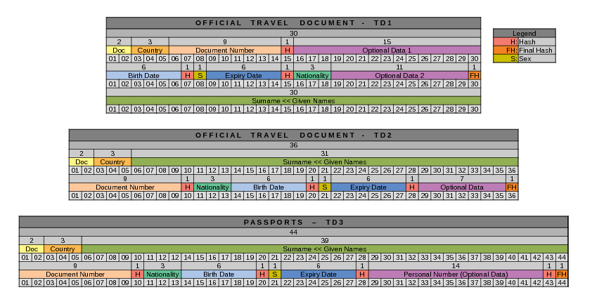

# Fast MRZ

<div align="center">

[](https://github.com/sivakumar-mahalingam/fastmrz/blob/main/LICENSE)
[](https://pypistats.org/packages/fastmrz)

[](https://github.com/sivakumar-mahalingam/fastmrz/actions/workflows/codeql.yml)
[](https://pypi.org/project/fastmrz/)

<a href="https://github.com/sivakumar-mahalingam/fastmrz/" target="_blank">
    
</a>

FastMRZ is an open-source Python package that extracts the Machine Readable Zone (MRZ) from passports, ID cards and visas. It accepts an image path, NumPy array, Base64 string, encoded image bytes, PDF or MRZ string.
Pure Python, no Tesseract: the only dependencies are `numpy`, `opencv-python-headless` and `pymupdf`.

[Features](#features) •
[Built With](#built-with) •
[Requirements](#requirements) •
[Install](#install) •
[Usage](#usage) •
[API reference](#api-reference) •
[Documentation](#documentation) •
[Wiki](#wiki) •
[ToDo](#todo) •
[Contributing](#contributing)

</div>

## 📚 Documentation

Comprehensive documentation is available at the [FastMRZ Documentation Site](https://sivakumar-mahalingam.github.io/fastmrz/):

- [Getting Started](https://sivakumar-mahalingam.github.io/fastmrz/getting-started/) - Installation and setup
- [How It Works](https://sivakumar-mahalingam.github.io/fastmrz/how-it-works/) - Architecture and processing pipeline
- [API Reference](https://sivakumar-mahalingam.github.io/fastmrz/api-reference/) - Complete API documentation
- [Supported Documents](https://sivakumar-mahalingam.github.io/fastmrz/supported-documents/) - Document types and MRZ formats
- [Input Formats](https://sivakumar-mahalingam.github.io/fastmrz/input-formats/) - Supported input types
- [Checksum Validation](https://sivakumar-mahalingam.github.io/fastmrz/checksum-validation/) - ICAO check digit details
- [Limitations](https://sivakumar-mahalingam.github.io/fastmrz/limitations/) - Known limitations
- [Contributing](https://sivakumar-mahalingam.github.io/fastmrz/contributing/) - How to contribute
- [Changelog](https://sivakumar-mahalingam.github.io/fastmrz/changelog/) - Version history

## ️✨Features

- 👁️Detects and extracts the MRZ region from document images, at any rotation, skew or perspective
- 🎨Built-in 2.5 MB ONNX recogniser, trained on synthetic MRZ data and run through OpenCV: no Tesseract or GPU needed
- 🆗Check digits validated per ICAO 9303, with automatic repair of misread characters
- 📄Image path, NumPy array, Base64, bytes, PDF and MRZ text input; parallel batch processing
- 📤Outputs the extracted MRZ as text or a parsed dict


## 🛠️Built With


## 📋Requirements

| | Supported | Tested |
|---|---|---|
| Python | 3.8 or newer | 3.8, 3.9, 3.10, 3.11, 3.12, 3.13 |
| numpy | any version that matches your OpenCV | 1.24.4 to 2.5.5 |
| opencv-python-headless | 4.8 or newer | 4.8.1, 5.0.0, 5.1.0 |
| PyMuPDF (PDF input) | 1.23 or newer, except 1.26.5 and 1.26.6 (security advisory) | 1.23.26, 1.24.11, 1.26.4, 2.1 |

No Tesseract, PyTorch or GPU needed.

## ⚙️Install

```bash
pip install fastmrz
```

PDF support is included; no extra is needed. From a clone of this repository: `pip install .`.

> **Upgrading from 2.x:** Tesseract and `mrz.traineddata` were removed in v3; you no longer need to install them.

## 💡Usage

```python
from fastmrz import FastMRZ

fast_mrz = FastMRZ()

details = fast_mrz.get_details("data/td3.jpg")                       # parsed dict
text = fast_mrz.get_details("data/td3.jpg", ignore_parse=True)       # raw MRZ text
details = fast_mrz.get_details(image_array, input_type="numpy")      # BGR/gray ndarray
details = fast_mrz.get_details(b64_string, input_type="base64")
details = fast_mrz.get_details(image_bytes, input_type="bytes")
details = fast_mrz.get_details("scan.pdf", input_type="pdf")         # path or bytes, first page with an MRZ
details = fast_mrz.get_details(mrz_string, input_type="text")        # parse only

is_valid = fast_mrz.validate_mrz(mrz_string)                          # {"is_valid": ..., "status_message": ...}
strip = fast_mrz.get_mrz_image("data/td3.jpg")                        # rectified MRZ crop

results = fast_mrz.get_details_batch(["a.jpg", "b.jpg", "c.jpg"])      # many images, in parallel
```

`get_details_batch(inputs, input_type="imagepath", ignore_parse=False, include_checkdigit=True, workers=None)`
returns results in input order and takes the same options as `get_details`. `workers` defaults to the number of CPUs (max 8).
A file that cannot be read does not stop the batch: its entry is `{"status": "FAILURE", "status_message": ...}` (or `""` with `ignore_parse=True`).
Expect about 1.5x the throughput of a plain loop on a 4-core CPU; OpenCV already uses several cores per image.

`FastMRZ(tesseract_path=..., tessdata_path=...)` is still accepted so existing code keeps working, but Tesseract was removed in v3: both arguments are ignored and raise a `FutureWarning`; remove them.

One `FastMRZ` instance can be shared across threads.

Supported formats: TD1 (3x30), TD2 (2x36), TD3 (2x44), MRV-A (2x44), MRV-B (2x36).

## 📖API reference

Type hints are included (`py.typed`), so editors and type checkers see the types below.

### `FastMRZ(tesseract_path="", tessdata_path="", model_path=None)`

| Parameter | Type | Default | Meaning |
|---|---|---|---|
| `tesseract_path` | `str` | `""` | Deprecated (Tesseract removed in v3), ignored, raises `FutureWarning` |
| `tessdata_path` | `str` | `""` | Deprecated (Tesseract removed in v3), ignored, raises `FutureWarning` |
| `model_path` | `str \| PathLike \| None` | `None` | Replacement recogniser ONNX model; default is the bundled one |

### Methods

| Method | Returns | Raises |
|---|---|---|
| `get_details(input_data, input_type="imagepath", ignore_parse=False, include_checkdigit=True)` | `dict[str, str]`; with `ignore_parse=True` the MRZ text (`str`, `""` if none found) | `ValueError` if the input can't be read |
| `get_details_batch(inputs, input_type="imagepath", ignore_parse=False, include_checkdigit=True, workers=None)` | `list`, one `get_details` result per input, in order | Nothing per input: unreadable inputs become `FAILURE` entries |
| `get_mrz_image(input_data, input_type="imagepath")` | `numpy.ndarray` (grey, `uint8`, 32 x 640 per MRZ line) or `None` | `ValueError` if the input can't be read |
| `validate_mrz(mrz_text)` | `{"is_valid": bool, "status_message": str}` | - |

### `input_type`

| Value | `input_data` |
|---|---|
| `"imagepath"` | Path to an image file (`str` or `pathlib.Path`) |
| `"numpy"` | Image array, BGR colour or greyscale |
| `"base64"` | Base64 encoded image file; `data:image/...;base64,` prefix allowed |
| `"bytes"` | Encoded image file (JPEG, PNG, ...) |
| `"pdf"` | Path or bytes of a PDF; first page (of up to 10) with an MRZ |
| `"text"` | MRZ text, lines separated by `\n`; parsed only, never auto-corrected |

### Output fields

All values are strings. Check-digit keys are left out with `include_checkdigit=False`.

| Key | Formats | Example | Meaning |
|---|---|---|---|
| `mrz_type` | all | `TD3` | `TD1`, `TD2`, `TD3`, `MRVA` or `MRVB` |
| `document_code` | all | `P` | Document type (`P`, `I`, `ID`, `V`, ...) |
| `issuer_code` | all | `UTO` | Issuing state |
| `document_number` | all | `L898902C3` | Long TD1 numbers continued in the optional data are joined |
| `document_number_checkdigit` | all | `6` | |
| `surname` | all | `ERIKSSON` | |
| `given_name` | all | `ANNA MARIA` | Given names separated by spaces |
| `nationality_code` | all | `UTO` | May be empty |
| `birth_date` | all | `1974-08-12` | `YYYY-MM-DD`; the raw `YYMMDD` if it isn't a calendar date |
| `birth_date_checkdigit` | all | `2` | |
| `sex` | all | `F` | `M`, `F`, `X` or `<` |
| `expiry_date` | all | `2012-04-15` | `YYYY-MM-DD`; the raw `YYMMDD` if it isn't a calendar date |
| `expiry_date_checkdigit` | all | `9` | |
| `optional_data` | TD2, TD3, MRVA, MRVB | `ZE184226B` | Personal number / optional data, fillers removed |
| `optional_data_checkdigit` | TD3 | `1` | |
| `optional_data_1`, `optional_data_2` | TD1 | | Optional data of line 1 and line 2 |
| `final_checkdigit` | TD1, TD2, TD3 | `0` | Composite check digit |
| `mrz_text` | all | | The MRZ lines joined by `\n` |
| `status` | all | `SUCCESS` | `SUCCESS` when the format and every check digit are valid, else `FAILURE` |
| `status_message` | on failure | `Final checksum is not matching` | First problem found |

When no MRZ is found the result is only `{"status": "FAILURE", "status_message": "No MRZ detected"}`.

Other `status_message` values: `Invalid MRZ format`, `Invalid date of birth`, `Invalid date of expiry`,
`Document number checksum is not matching`, `Date of birth checksum is not matching`,
`Date of expiry checksum is not matching`, `Optional data checksum is not matching`.

## 📃Wiki

For detailed information about MRZ types, formats, and ICAO Doc 9303 specifications, see the [Supported Documents](https://sivakumar-mahalingam.github.io/fastmrz/supported-documents/) documentation.

<details>
    <summary><b>MRZ Types & Format</b></summary>

The standard for MRZ code is strictly regulated and has to comply with [Doc 9303](https://www.icao.int/publications/pages/publication.aspx?docnum=9303). Machine Readable Travel Documents published by the International Civil Aviation Organization.

There are currently several types of ICAO standard machine-readable zones, which vary in the number of lines and characters in each line:

- TD-1 (e.g. citizen's identification card, EU ID card, US Green Card): consists of 3 lines, 30 characters each.
- TD-2 (e.g. Romania ID, old type of German ID), and MRV-B (machine-readable visas type B — e.g. Schengen visa): consists of 2 lines, 36 characters each.
- TD-3 (all international passports, also known as MRP), and MRV-A (machine-readable visas type A — issued by the USA, Japan, China, and others): consist of 2 lines, 44 characters each.

Now, based on the example of a national passport, let us take a closer look at the MRZ composition.



</details>


## ✅ToDo

- [x] Include mrva and mrvb documents
- [x] Add wiki page
- [x] Support numpy array as input
- [x] Support mrz text as input
- [x] Support base64 as input
- [x] Add documentation page
- [x] Support pdf as input
- [x] Bulk process
- [x] Replace Tesseract with a built-in ONNX recogniser (Tesseract removed in v3)
- [x] Add function parameter - include_checkdigit
- [x] Add function - get_mrz_image
- [x] Add function - validate_mrz
- [ ] Extract face image
- [ ] Add all checkdigit status

## 🤝 Contributing

Contributions are welcome! Here's how you can help:

1. Fork the repository
2. Create a new branch (`git checkout -b feature/amazing-feature`)
3. Make your changes
4. Commit your changes (`git commit -m 'feat: add amazing feature'`)
5. Push to the branch (`git push origin feature/amazing-feature`)
6. Open a Pull Request

## ⚖️License

Distributed under the AGPL-3.0 License. See `LICENSE` for more information.

## 🙏Show your support

Give a ⭐️ if <a href="https://github.com/sivakumar-mahalingam/fastmrz/">this</a> project helped you!

## 🚀Who's Using It?

We’d love to know who’s using **fastmrz**! If your company or project uses this package, feel free to share your story. You can:

- Open an issue with the title "We are using fastmrz!" and include your project or company name.

Thank you for supporting **fastmrz**! 🤟


